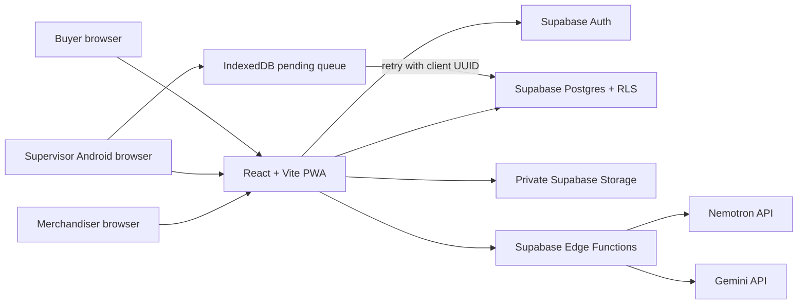

# Threadline architecture

## Runtime shape

The React client is a static single-page PWA. React + Vite keeps the buyer and operations screens lightweight and makes offline capture independent of a server-rendering request. Supabase is the system of record for authentication, relational data, private media and server-side functions. Sensitive AI and service-role credentials live only in Edge Function secrets.

## Access boundaries

- Authenticated users have a `profiles` role. The role is read from the database, not selected by the live client.
- Postgres RLS protects each table. `can_access_order` limits supervisor access to assigned stages and buyer access to an explicitly mapped buyer account.
- Buyer progress, remarks, milestone and photo-path RPCs return only buyer-approved fields. The signed-media Edge Function verifies the buyer mapping and photo approval with the caller's JWT before using the service key to create a short-lived URL.
- The private `production-evidence` bucket is not public. A photo approval is a separate record from upload.
- Writes to production updates are append-only; corrections belong in audited amendments.

## Data flow

1. Merchandiser creates a draft through `create_order_draft`; Postgres validates size rows and derives total quantity.
2. Merchandiser chooses an active route and TNA template in the planning screen. The RPC stores an order-specific route and reviewed dates. Releasing requires an assigned active supervisor for each applicable stage.
3. Supervisor update is saved to IndexedDB first with a client-generated UUID, then media is uploaded and the production row is upserted on that UUID. Replaying the UUID does not create a second quantity row.
4. Issue review can request a transcript or an advisory translation. The human reviewer edits and approves the issue; buyer-safe remarks have a separate checkbox.
5. Risk is deterministic. It stays insufficient without an approved non-provisional unit risk policy and a configured calendar. No AI call changes quantities, status or dates.
6. Weekly exports are generated from buyer-scoped order data and include buyer-visible milestones only. Their generation is logged in `weekly_reports`.

## Important trade-offs and open work

- SPA/PWA is selected over Next.js because the product is an authenticated operations workspace and does not need public-page SEO or server-rendered buyer pages. Supabase functions provide server-side privileged work.
- Offline persistence uses IndexedDB. It survives reloads and network loss but not a user clearing browser storage, device loss or browser eviction. A native Android wrapper or device backup strategy may be needed after field testing.
- Browser-created PDF/XLSX files are generated on the signed-in client. For stronger tamper resistance and shared report archives, move generation to an authenticated server function and store a private export.
- Tamil transcription uses Gemini behind a human-triggered function. Provider quality, data retention, audio formats and quota must be validated with consented factory samples.
- Admin setup now includes creating buyers, units/calendars, lines, stage/TNA templates, holidays and approved unit risk policies; account invitation and buyer-user mapping remain manual. Automated RLS tests and production monitoring remain open implementation items.
